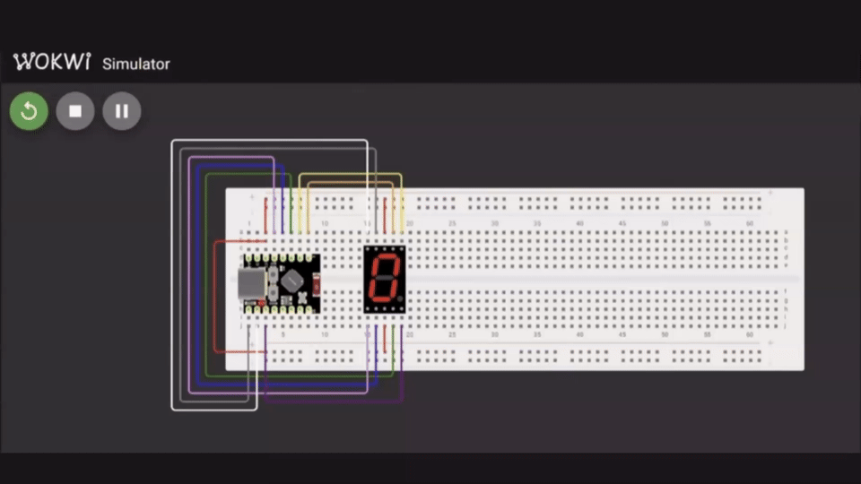

# ESP32-C3 — Display de 7 Segmentos com ESP-IDF

Projeto em linguagem C utilizando ESP-IDF para controle de um display de 7 segmentos com ESP32-C3.

A aplicação exibe sequencialmente os valores hexadecimais de `0x0` até `0xF` e controla o ponto decimal de acordo com a paridade do valor exibido.

## Objetivo

Praticar conceitos fundamentais de sistemas embarcados utilizando ESP32-C3, ESP-IDF e FreeRTOS, com foco em:

- configuração de GPIOs;
- manipulação de bits;
- representação hexadecimal;
- uso de `switch`;
- controle de display de 7 segmentos;
- temporização com `vTaskDelay()`.

## Demonstração

<p align="center">
  
</p>

## Funcionamento

Os GPIOs `0` a `7` são configurados como saídas digitais e conectados aos segmentos do display.

| GPIO | Segmento |
|---|---|
| GPIO0 | A |
| GPIO1 | B |
| GPIO2 | C |
| GPIO3 | D |
| GPIO4 | E |
| GPIO5 | F |
| GPIO6 | G |
| GPIO7 | DP |

A organização dos bits é:

```text
Bit:  7   6   5   4   3   2   1   0
      DP  G   F   E   D   C   B   A
```

O display utiliza lógica ativa em nível baixo:

```text
0 -> segmento aceso
1 -> segmento apagado
```

## Codificação hexadecimal

A função:

```c
unsigned char codifica_Display(int numero);
```

converte valores de `0x0` até `0xF` em padrões de 8 bits correspondentes aos segmentos do display.

Exemplo:

```c
case 0x0: return 0b11000000;
case 0x1: return 0b11111001;
```

## Escrita no display

A função:

```c
void mostra_Display(unsigned char codificado, int contagem);
```

percorre os 8 bits do valor codificado e envia cada bit ao GPIO correspondente:

```c
gpio_set_level(segmentos[i], (codificado >> i) & 1);
```

O ponto decimal é acionado em valores ímpares:

```c
if (contagem % 2 == 1) {
    gpio_set_level(segmentos[7], 0);
}
```

## Configuração dos GPIOs

Os pinos são configurados com `gpio_config_t` utilizando uma máscara de bits:

```c
.pin_bit_mask =
    (1ULL << GPIO_NUM_0) |
    (1ULL << GPIO_NUM_1) |
    (1ULL << GPIO_NUM_2) |
    (1ULL << GPIO_NUM_3) |
    (1ULL << GPIO_NUM_4) |
    (1ULL << GPIO_NUM_5) |
    (1ULL << GPIO_NUM_6) |
    (1ULL << GPIO_NUM_7)
```

Todos são configurados como saída, sem pull-up, pull-down ou interrupção.

Na inicialização, todos os segmentos são mantidos apagados colocando os GPIOs em nível alto.

## Sequência exibida

O programa percorre continuamente:

```text
0 1 2 3 4 5 6 7 8 9 A B C D E F
```

Cada valor permanece no display por aproximadamente 1 segundo:

```c
vTaskDelay(1000 / portTICK_PERIOD_MS);
```


## Simulação

O circuito utiliza:

- ESP32-C3 Super Mini;
- display de 7 segmentos;
- protoboard;
- Wokwi para simulação.

O arquivo `diagram.json` contém a montagem virtual do circuito.

## Compilação

Com o ambiente ESP-IDF configurado:

```powershell
cd C:\ESP32C3\display7Seg
idf.py build
```

Depois do build, a simulação pode ser iniciada pelo Wokwi no Visual Studio Code.

## Tecnologias

- C
- ESP-IDF
- ESP32-C3
- FreeRTOS
- Wokwi

## Autor

Giuseppe Meneghini
